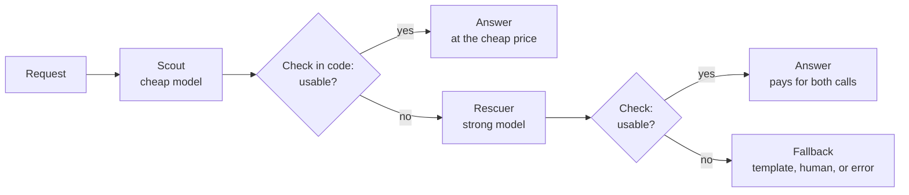
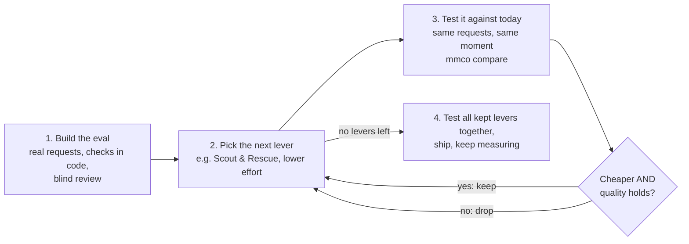

# AI Mixed Model Cost Optimization

**Prove an AI cost cut on your own traffic before you ship it. Let cheap and strong models work together, and measure cost per outcome — not cost per token.**

**In 30 seconds:**
- **What it is:** a method and a small Python tool. A cheap model does the work first; a strong model steps in only when a check in code rejects the result (*Scout & Rescue*). Every change is tested side by side against your current setup on your own requests, with a blind quality review.
- **What we measured:** on a live app's web-search step, cost per article fell from 9.7 ¢ to 4.6–7.7 ¢, and quality held in a blind review. On 40 support tickets, a usable, correct reply cost 0.12 ¢ instead of 1.05 ¢ with Claude Opus 5.5 alone — 89% less per outcome.
- **The trade-off:** on the support tickets, quality was 2–6% lower, and one wrong refund rule slipped past the checks. Your checks decide how much quality you keep.

## When it fits

It fits when your product sends a lot of requests to a frontier model — such as Claude Opus 5.5 or Fable 5.2, GPT-6.2 Astra, or Gemini 4 Carbon — to read, analyze, review or summarize data. For example:
- support chatbots
- code-review bots
- data extraction
- search and research assistants
- document summarizers

And most of those requests are routine, and a bad result can be detected in code: an empty result, a missing field, an outdated date, or an invalid format.

## What this measures

Most cost tools stop at the first row. This method measures the second before you ship, and tells you how to track the third after.

| Layer | The question | Who asks it | Where it is measured |
|---|---|---|---|
| Model output | What does a token cost? How fast is the model? | Engineers | Price lists, benchmarks |
| **Outcome** (before shipping) | Did the user get a usable, correct result — and what did that result cost, including failed attempts? | Product, engineering | **The eval: `mmco compare` on your own requests** |
| **Value shipped** (after shipping) | How much margin did we bank per user, without more complaints, escalations or refunds? | CFO, VP Product | Ship behind a switch, keep measuring — [method, step 9](https://github.com/AndyJakob78/ai-mixed-model-cost-optimization/blob/main/docs/method.md#step-9--ship-behind-a-switch-keep-measuring) |

**The eval proves you won't break the product. The switch and the ledger prove the margin you banked.**

## Target audience

| Role | What you get |
|---|---|
| **Product Manager** | A way to cut AI cost per user with evidence, and to defend every keep-or-drop decision |
| **System Designer** | A pattern for splitting one AI job into steps, each with the right model |
| **AI Engineer** | A small Python package: Scout & Rescue, multi-model pipelines, and a test runner (`mmco compare`) |
| **Prompt & Context Engineer** | A test routine that shows whether a prompt change really saves tokens — or quietly costs more |
| **AI Builder** | A way to test cheaper setups for an AI app on a small budget, and keep only those that hold quality |
| **AI Evaluation** | A blind A/B review setup and a fixed scoring sheet |
| **LLMOps** | Code checks and logging that track how often the expensive model runs |
| **FinOps** | A clear before-and-after cost per request, and the yearly saving at your scale |

## The problem

Some AI features cannot afford a weak answer. **Compliance, regulation or safety** may demand it — a wrong fact in a financial, medical or legal answer is a real risk. Or the **user experience** depends on it — one confidently wrong answer and users stop trusting the product.

So teams do the safe thing: **one strong model does the whole job, end to end, for every request.** Quality is high. But:
- **You pay top price for easy work.** Most requests are routine and don't need the strongest model. They are still billed at its rate.
- **The cost grows with every user.** At scale, a request can cost more than it earns.
- **The usual fixes put quality at risk.** "Switch to a smaller model" or "shorten the prompt" may save money, or may quietly lower quality, or may even raise cost. Without a test, you can't tell.

**What this method can and cannot do:** it saves money on the requests where a cheap model's mistakes can be caught by a check in code — an empty result, a missing field, an old date, an invalid format. It does **not** catch an answer that looks right but is wrong, such as a plausible but false refund rule. Where such errors carry legal or safety risk, either build a check that really catches them, or keep that step on the strong model.

### Real-world signals (2026)

**AI cost is squeezing companies:**
- **Harvey** (legal AI): in March it updated its AI agents, and customers began using them far more — token use grew about 20× during the year. Harvey mostly charges customers a fixed price per seat but pays the model providers per token, so its gross margin reportedly fell from about **+50% to −50%** by June: serving customers cost about $1.50 for every $1 of revenue. In August it moved its flagship to its own model built on an open-weight model, and margins reportedly turned positive again. [Bloomberg](https://www.bloomberg.com/news/articles/2026-09-21/startups-like-harvey-embrace-open-models-to-cut-reliance-on-anthropic-openai) · [Artificial Lawyer](https://artificiallawyer.com/2026/07/08/harvey-increases-token-use-14x-in-just-6-months)
- **Industry survey** (Mavvrik, a cost-management vendor, with Benchmarkit; 396 companies, April–May 2026):
  - **62%** say an unexpected AI cost changed a business decision in the past year. Of those, 40% had to escalate it to the board, 33% froze spending, and 25% delayed or cancelled an AI project.
  - **49%** had to raise prices of their AI products because costs rose more than expected.
  - Only **11%** can forecast their AI spend within ±10% (down from 15% in 2025).
  - **43%** name token costs as a top source of surprise spend. Agents are a growing blind spot: almost all companies run them, but only about a third include them in cost reports.
  - [Channel Insider](https://www.channelinsider.com/ai/mavvrik-state-of-ai-cost-governance/) · [CFO Dive](https://cfodive.com/news/1-in-4-companies-delay-cancel-ai-projects-over-cost/827524) · [Diginomica](https://diginomica.com/tokenomics-ai-bill-shock-goes-mainstream-key-cost-driver-becomes-task-complexity)

**And when an AI answer is wrong, courts hold the company liable:**
- **Hamm, Germany (May 2026):** a clinic's website chatbot invented specialist titles for its doctors. The Higher Regional Court held the clinic responsible — even though the bot had been trained on correct data and was run by an IT provider. Switching the bot off was not enough; the clinic also had to sign a cease-and-desist declaration. Not yet final: an appeal to the Federal Court of Justice is allowed. [Court press release (German)](https://www.justiz.nrw/presse/2026-05-12) · [DLA Piper](https://www.dlapiper.com/en/insights/publications/2026/06/german-court-addresses-liability)
- **Munich, Germany (May 2026):** Google's AI Overviews made false claims about two publishers that did not appear in the linked sources. The Regional Court of Munich treated the AI summary as Google's own statement and barred Google from repeating it, with fines of up to €250,000 per violation. Not yet final. [Court press release (German)](https://www.justiz.bayern.de/gerichte-und-behoerden/landgericht/muenchen-1/presse/2026/13.php) · [The Decoder](https://the-decoder.com/landmark-german-ruling-declares-googles-ai-overviews-are-googles-own-words-and-makes-it-liable-for-false-answers/)

The lesson: cut cost **and** prove quality, one change at a time — with tests on real requests, not just offline benchmarks.

### What this looked like for us

**The project:** a live language-learning app that turns current local news into reading lessons. Every lesson starts with an AI step that searches the web for one fresh, **true** story. A wrong or outdated fact would be taught to the learner as true, so we ran this step on a strong model for every lesson: **Claude Sonnet 5.5 with full web search**. It cost **9.7 cents per article**. A lesson uses AI twice: once to find the story and once to write the lesson. Finding the story was about half of the lesson's total AI cost, and every lesson a free user read was paid for out of pocket.

**Before and after, per article:**

| | Before | After | What it means |
|---|---|---|---|
| Setup | Claude Sonnet 5.5 + full web search, for every article | **Scout:** Claude Haiku 5.5 + simple web search. **Rescue:** Sonnet 5.5 + full web search | The rescuer runs only when a code check finds no usable story or only an old one — 2 to 5 of every 18 articles. |
| Cost per article (average) | 9.7 ¢ | **4.6 – 7.7 ¢ (−53% to −21%)** | Depends on how often the rescuer runs (2 to 5 of every 18 articles across our runs); rescued articles pay for both attempts. The final combined test against production gave 4.6 ¢. |
| Cost per article (typical) | 9.2 ¢ | **2.6 ¢ (−71%)** | Median from the final combined test: most articles finish on the scout. |
| Quality, blind review (18 articles, max 540) | 434 | **472** | Quality held or improved. This is one blind review of 18 articles, scored by an AI model on a fixed rubric; we did not measure how much this score varies between runs, and in another paired run Scout & Rescue scored level with its competitor (437 vs 429). Likely reasons for the gain: the freshness check sends old stories to the rescuer, and new fact rules keep contact details, guessed descriptions and facts that sources disagree on out of the lesson. We did not measure each reason separately. |
| Time per search (average) | 34 s | 34 s | Same average, wide spread: in a second comparison run, a typical article took about 14 s on the scout; a rescued article takes the scout's time plus the rescuer's, which pulls the average up. The same setup run twice varies by about ±10%. |
| Lessons without an article | 0 | 0 | Every one of the 18 test requests ended with a usable story — a test result, not a guarantee. Two cheaper ideas failed here: the scout alone left 1 of 18 learners without a story, and a "lazier" rescuer was 22% cheaper but let old stories through (quality 440 vs 470). |

**Over a year:** 1,000 users reading one article a day is 365,000 articles.

| | Best run (4.6 ¢) | Most rescues (7.7 ¢) |
|---|---|---|
| Before (9.7 ¢ per article) | $35,405 | $35,405 |
| After | $16,790 | $28,105 |
| **Saved** | **$18,615** | **$7,300** |

Costs cover the search step only, at the API prices of our test, extrapolated from 18 test requests. Your own rescue rate decides where you land.

### A second example: a service chatbot (estimate)

An online shop's chatbot sends every turn to Claude Opus 5.5: **2.6 cents per turn, about $156,000 a year** at 500,000 turns a month. Split into steps — Haiku 5.5 to understand the message, Scout & Rescue (Haiku first, Opus only when a check rejects the draft) to answer, and Sonnet 5.5 for one daily summary:

| How often Opus is still needed | Cost per year | Saved |
|---|---|---|
| 1 in 5 turns | $36,200 | **$119,800 (−77%)** |
| 2 in 5 turns | $67,400 | **$88,600 (−57%)** |

These numbers come from assumptions, not a measurement, and are an upper estimate: they leave out prompt caching, which would make the "before" setup cheaper and the saving smaller. → [Full chatbot example, with the checks and how to prove it](https://github.com/AndyJakob78/ai-mixed-model-cost-optimization/blob/main/docs/example-service-chatbot.md)

### Measured: support replies

We then ran the support-reply step of this idea for real: 40 made-up tickets (20 of them hard), Claude Haiku 5.5 as the scout, Opus 5.5 as the rescuer, against Opus 5.5 alone, with a blind review.

| | Scout & Rescue | Opus 5.5 alone |
|---|---|---|
| Cost per reply | **81–88% less** | — |
| Quality (blind review, two runs) | **2–6% lower** | — |
| Hard failures (run 2, 40 tickets) | 3 | 2 |
| **Cost per outcome** (run 2) | **0.12 ¢** (36 of 40) | 1.05 ¢ (35 of 40) |

**Good for cost, with a quality trade-off.** Most cheap replies were good, but some were weaker in ways no check saw, and one stated a wrong refund rule. Use it where a few percent of quality is acceptable, or where your checks catch the mistakes that matter; keep refund, money and legal answers on the strong model until they do. → [Full results, caveats and how to rerun it](https://github.com/AndyJakob78/ai-mixed-model-cost-optimization/blob/main/docs/support-test.md)

**And where a cheap model is already in use:** in a game that writes an AI newspaper article per match day, the cheap model passed every check, so the rescuer never ran. The strong model alone cost 18× more for 13% better text, and the blind review found fact errors in both that no check caught. The better lever there is a better check, not a bigger model. → [Game article test](https://github.com/AndyJakob78/ai-mixed-model-cost-optimization/blob/main/docs/game-article-test.md)

## The solution

**1. Break the job into steps, and give each step the right model.** A recommended starting point — our case study tested this on one step (the search), not a full pipeline.

| Step | Recommended starting point |
|---|---|
| Read / extract | small, cheap model |
| Analyze / draft | **Scout & Rescue** (see below) |
| Review | a check in code where possible |
| Aggregate | mid-size model, once per batch |

**2. Scout & Rescue for the steps that are usually easy but sometimes hard.** A cheap model (the scout) tries first. A strong model (the rescuer) runs only when a check in code says the scout's result is unusable. When most requests pass the check, most finish at the cheap price; the rest get the same strong model you use today.



The checks decide the quality: a mistake no check catches goes straight to the user at the cheap price.

**Expect a small quality cost.** Requests that pass the check are only as good as the cheap model's answer. In our support test, Scout & Rescue cost 81–88% less than the strong model alone and scored 2–6% lower in a blind review — a much stronger cost lever than tuning the strong model, with a quality trade-off you should measure for your own task. How much quality you keep depends mostly on your checks.

```python
from mixed_model_cost import scout_and_rescue
from mixed_model_cost.claude import claude

outcome = scout_and_rescue(
    prompt,                      # your request
    scout=claude("claude-haiku-5-5"),
    rescue=claude("claude-opus-5-5"),
    check=lambda text: None if order_id in text else "does not mention the order id",  # order_id from your data
)
print(outcome.path, outcome.cost_usd)  # "scout" or "rescue" - how often each runs depends on your checks
```

**Install** (version 0.3, early: the API may still change; Python 3.10+, Gemini adapter 3.11+):

```bash
pip install "ai-mixed-model-cost-optimization[claude]"
```

| You install | You import | You run |
|---|---|---|
| `ai-mixed-model-cost-optimization` | `mixed_model_cost` | `mmco` |

```python
from mixed_model_cost import scout_and_rescue
from mixed_model_cost.claude import claude   # or .openai / .gemini
```

The core has no dependencies and works with any provider: a model is just a function `prompt -> ModelResult`. Adapters come as extras: `[claude]`, `[openai]`, `[gemini]` or `[all]`. For a local model, write a function with the same shape.

**Test a change on your own requests** with one command — it runs every setup on every request, side by side, and prints cost (average and median), rescue rate, time, check failures and blind-review quality:

```bash
mmco init my_test.py            # a starter test that runs straight away, with fake models
mmco compare my_test.py --live
```

→ How to write `my_test.py`, plus a support-ticket demo that works without an API key: [examples/](https://github.com/AndyJakob78/ai-mixed-model-cost-optimization/blob/main/examples/). The live Claude mode was run in the [support test](https://github.com/AndyJakob78/ai-mixed-model-cost-optimization/blob/main/docs/support-test.md).

**A second, smaller lever: lower effort on the strong model.** In the same test, running the rescuer at effort low instead of medium cost 24–25% less in two runs, with no measurable quality loss on the rescued tickets. Measured on short support replies only.

**3. Prove every change before you ship it.** Change one thing at a time. Run the old and new versions side by side on the same requests. Review quality blind, as A vs. B. Keep only what saves money *and* holds quality.

The test setup is an **eval**: a fixed set of real requests, checks in code and a blind review, built once and reused for every change. Without it you can't tell a saving from a quality loss.



The full flow, with the cost breakdown and the ledger: [method.md](https://github.com/AndyJakob78/ai-mixed-model-cost-optimization/blob/main/docs/method.md#the-flow)

→ The step-by-step method: [docs/method.md](https://github.com/AndyJakob78/ai-mixed-model-cost-optimization/blob/main/docs/method.md) · Templates: [templates/](https://github.com/AndyJakob78/ai-mixed-model-cost-optimization/blob/main/templates/)

## How this differs from other tools

The technique is not new: a cheap model first and a strong one on failure is a well-known *LLM cascade* (see [FrugalGPT](https://github.com/stanford-futuredata/FrugalGPT)). What is less common is the workflow around it: prove the cut on your own traffic, one change at a time, and publish what failed.

| Tool | What it does | How it relates |
|---|---|---|
| [RouteLLM](https://github.com/lm-sys/RouteLLM) | Trained routers that pick a model per request | A routing technique. You can test it against your setup with `mmco compare`. |
| [cascadeflow](https://github.com/lemony-ai/cascadeflow) | A cascading runtime for agents, with streaming and tool-call routing | A runtime for production. Test it here first. |
| [LiteLLM](https://github.com/BerriAI/litellm) | A gateway to 100+ model APIs | Infrastructure to call models. Works as the model behind a setup here. |
| [promptfoo](https://github.com/promptfoo/promptfoo) | Broad testing of prompts, agents and RAG, plus red teaming | A general eval suite. This repo is narrower: one cost change at a time, judged by cost per outcome. |

**Use this when** you want evidence on your own requests before you commit to a router or gateway — or to show that a cheaper setup really holds quality. **Use the others when** you need production routing at scale.

## The full story

We tested 12 cost-saving ideas one at a time, and **7 raised cost or lowered quality**. For example, a shorter prompt made the model search *more*.

→ [Case study](https://github.com/AndyJakob78/ai-mixed-model-cost-optimization/blob/main/docs/case-study.md) · [Support test](https://github.com/AndyJakob78/ai-mixed-model-cost-optimization/blob/main/docs/support-test.md) · [Game article test](https://github.com/AndyJakob78/ai-mixed-model-cost-optimization/blob/main/docs/game-article-test.md) · [Scout & Rescue in detail](https://github.com/AndyJakob78/ai-mixed-model-cost-optimization/blob/main/docs/scout-and-rescue.md) · [Lessons](https://github.com/AndyJakob78/ai-mixed-model-cost-optimization/blob/main/docs/lessons.md)

## Terms used on this page

- **Token:** the unit AI providers bill by — roughly a short word of text the model reads or writes.
- **Lever:** one change that should lower cost, such as a smaller model or a shorter prompt. Each lever is tested on its own.
- **Scout:** the cheap, fast model that tries first.
- **Rescuer:** the strong model that runs only when a check in code rejects the scout's result.
- **Full web search:** a search tool that filters the results with code before the model reads them. Fewer pages to read, but more steps.
- **Simple web search:** a search tool that hands the raw results straight to the model. Fewer steps; the model reads everything it gets, which is cheap on a small model but expensive on a large one.
- **Blind review:** a reviewer scores two results labelled only A and B, without knowing which setup made which.
- **Eval:** the fixed test that decides whether a change is kept — real requests, checks in code and a blind review, run the same way every time.
- **Outcome:** a request whose final result passed your checks and, if reviewed, had no hard failure — a result a user could rely on.
- **Cost per outcome:** everything a setup spent, including failed and rescued attempts, divided by its outcomes. The number to compare.
- **Typical (median):** the middle value — half the requests cost less, half more. Unlike the average, a few expensive outliers don't move it.

## About

Built from a real cost-reduction project on a live language-learning app. Engineering, testing and blind reviews were done with an AI coding assistant (Claude); a product owner made every keep-or-drop decision from the results.

Text: [CC BY 4.0](https://github.com/AndyJakob78/ai-mixed-model-cost-optimization/blob/main/LICENSE). Code in [src/](https://github.com/AndyJakob78/ai-mixed-model-cost-optimization/blob/main/src/) and [examples/](https://github.com/AndyJakob78/ai-mixed-model-cost-optimization/blob/main/examples/): [MIT](https://github.com/AndyJakob78/ai-mixed-model-cost-optimization/blob/main/LICENSE-CODE). Use it, adapt it, credit it.
