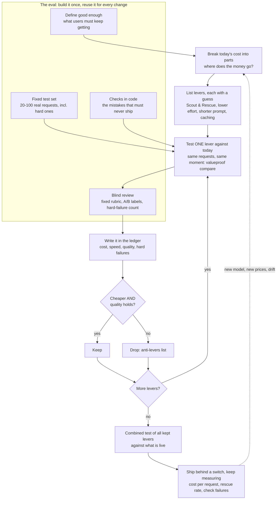

# The Valueproof method

A way to cut the running cost of an AI feature with evidence instead of intuition. It assumes nothing about the model vendor, the language or the framework. You need: the feature, a fixed set of test requests, a way to log tokens per call, and a reviewer for blind judging.

Roles: a **product owner** who decides, and an **engineer** — a person or an AI coding agent — who changes one thing at a time and runs the tests. The owner never decides from an argument, only from the ledger.

## The flow

Steps 0, 3 and 5 together are the **eval**: built once, reused for every lever.

---

## Step 0 — Define "good enough" before you start

Write down, in one paragraph, what the feature must keep doing for users. Example from the case study: *"Find one current, true story for the learner's topic and place, with enough facts to write a lesson. Never leave the learner without an article. Don't make them wait longer."*

From that paragraph come the three things every test measures:

| Measure | How | Notes |
|---|---|---|
| **Cost** | Tokens per call × price, plus tool fees | Log token counts from the API response for every call. Price each call by *its own* model. |
| **Speed** | Seconds per call | Report the median as well as the average — a few slow outliers hide in the average. |
| **Quality** | Blind score on a fixed rubric | Plus a count of **hard failures** (no answer, wrong place, invented facts), which no average may hide. |

## Step 1 — Break the cost into parts

Before listing ideas, find out *where* the money goes. Split the cost of one call into:

- **Tool fees** — web searches, retrievals, other paid tools.
- **Storing what the model reads** — prompts, documents, tool results written into the context (with prompt caching this is the cache-write price).
- **Re-reading** — agentic loops read the growing context again at every step (cache reads).
- **Writing** — output tokens, including internal "thinking".

In the case study the expected culprit (search fees) was only a quarter of the cost; storing what the model read was the largest part. Every later decision depended on this split.

## Step 2 — List the levers, with a guess

A lever is one change that should shrink one part of the cost. Write each down with:

- what exactly changes,
- which cost part it targets,
- **your estimate before testing** (e.g. "20–30% cheaper"),
- the risk to quality.

Typical levers: a smaller or cheaper model; less reasoning effort; a shorter prompt; fewer tool calls; skipping a step; a different tool version; caching; doing work only when a user will actually see it.

Writing the estimate down first matters: in the case study the estimates were wrong far more often than right, and seeing that is what keeps a team honest.

## Step 3 — Build a fixed test set

- 9–18 real requests that cover the range: easy and hard, big and small, every language or market.
- Include the cases you are afraid of (in the case study: small towns with little news).
- Keep the set fixed for the whole project, so every lever is compared on the same inputs.
- Add a few **targeted cases** for rare problems (a fact two sources disagree on, a name a model tends to mistranslate). Rare problems don't show up in a general set.

## Step 4 — Test one lever at a time, paired

- Put each lever behind a **test switch** (an environment variable), so production behaviour never changes during testing.
- Run the **baseline and the lever at the same moment**, on the same requests. Provider speed and search results change during the day; comparing against yesterday's baseline measures the weather, not the lever.
- Run the baseline twice on day one to learn your **noise level**. In the case study it was about ±10%. A lever must beat that to count.
- Check that the switch really did what you think — log which model answered. (A shell quirk once ran a "small model" test on the big model; only the log revealed it.)

## Step 5 — Judge quality blind

*Two ways to review blind: side by side as A and B (described here, good for a person), or one result at a time with the setup hidden (what `valueproof compare` does with a judge function, and what its review sheet contains). Both work; keep to one within a project.*

- Put the two outputs for each request side by side as **A and B**, randomly swapped, with no label saying which setup produced them.
- Let a reviewer score each on a **fixed rubric** — the same rubric for every lever (see [templates/blind-review-rubric.md](../templates/blind-review-rubric.md)).
- Map the scores back to the setups only afterwards.
- A model makes a good reviewer for this: consistent, fast and cheap. Spot-check its reasoning, and give it only the outputs, never your hypothesis.
- Read the reviewer's flagged problems — invented details, contradictions, stale stories. They are worth more than the totals.

## Step 6 — Write the ledger

One card per lever (see [templates/ledger.md](../templates/ledger.md)):

- what changed and the estimate before testing,
- cost, time (average and median), hard failures,
- blind score against its paired baseline,
- a one-paragraph verdict in plain language.

**Rejected levers stay on the ledger.** They are the evidence that the accepted ones were not luck, and they stop the same idea from being re-tried next quarter.

A shared page works best. In the case study it was a small web page that was republished after every test, so the owner could follow from a phone.

## Step 7 — Decide from the ledger

Keep a lever only if:

1. its cost or speed gain is **larger than the noise**, and
2. its blind score is **not lower** than the paired baseline (allow a few points), and
3. it adds **no hard failures**.

A lever that costs nothing and shows no effect (a safety rule that never fired) may be kept — say so on the card.

## Step 8 — One combined test against what is live

Levers interact. Switch every accepted lever on together and test that against **the code that runs in production today** — same requests, same moment, blind review. This is the number you report and the setup you ship.

Then compare the winner against its strongest single competitor as well. In the case study, the simplest cheap setup alone looked faster in its first test; side by side it was slower in the typical case and once returned nothing.

## Step 9 — Ship behind a switch, keep measuring

The eval proved the change won't break the product. Now prove the **value shipped**: the margin you banked, without hurting users.

- Ship with the switch on by default and an off switch for emergencies. Where you can, start with a share of users and compare them with the rest.
- Log per call which path ran (cheap or rescue), its cost and time, and whether the check passed.
- **Track the business numbers, before and after:**

| Number | Why | Switch back when |
|---|---|---|
| AI cost per active user (or per order, per seat) | The margin you banked | It rises above the old setup |
| Cost per outcome in production | Failed and rescued attempts included | It drifts up week over week |
| Rescue rate | The main cost driver over time | It climbs: inputs changed, the checks need work |
| Support escalations, complaints, refund disputes, "talk to a human" | Quality as users feel it | Any of them rises against the users without the change |
| Retention or repeat use of the feature | The long-term signal | It drops against the users without the change |

- Report it as value shipped: *"AI cost per user −X%, complaints unchanged, over N weeks."* That is the sentence a CFO funds.
- Re-run the fixed test set when prices or models change. A lever rejected today may win after the next price list.

---

## Rules of thumb

- **Measure the split before you have ideas.**
- **One lever per test. Same moment. Same requests.**
- **Blind or it didn't happen.**
- **Count failures separately from averages.**
- **Write the estimate down first.**
- **Keep the losers on the page.**
- **Check your price assumptions** against the current price list.
